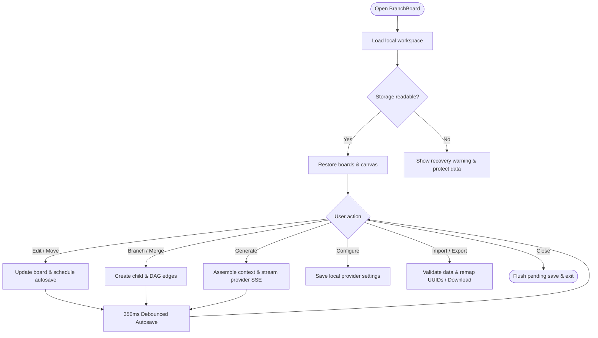
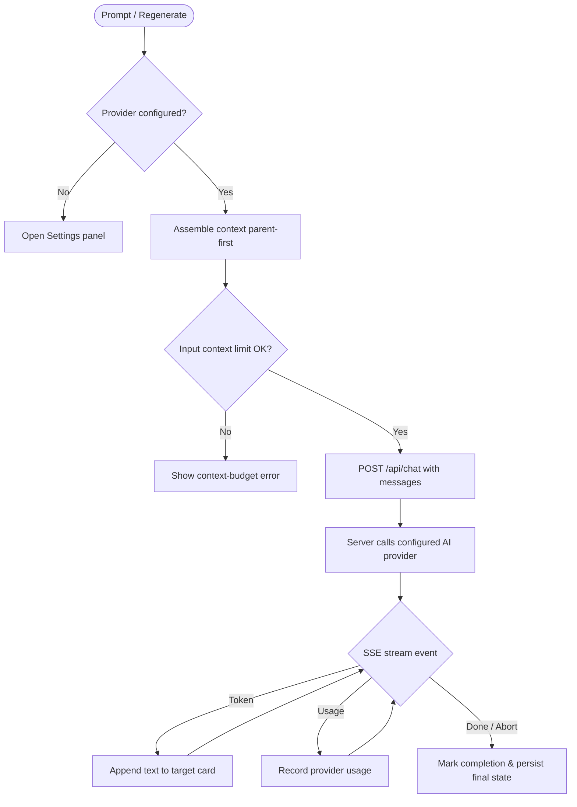
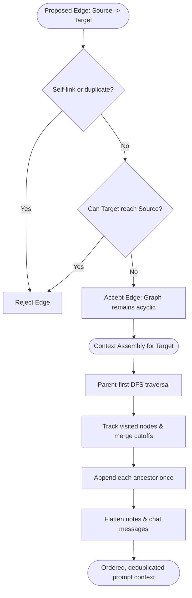
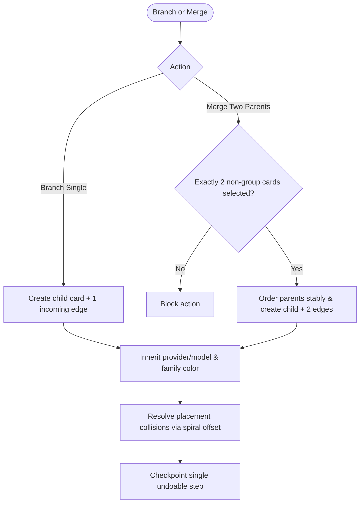
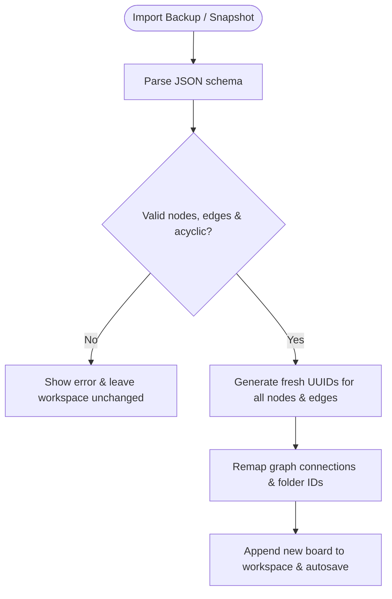

# BranchBoard — Product Requirements Document

| Field | Value |
|---|---|
| Document version | 1.0 (Streamlined) |
| Date | October 30, 2026 |
| Status | Ready for team review |
| Baseline | v1.10.1 (`5de8c581226d743637621a7de4cf87953adfddb8`) |
| Team | Cresol3127, clwr2007, ullash-naik, Atharva1232 |
| Repository | <https://github.com/Cresol3127/branchboard> |

---

## 1. Executive Summary & Problem Statement

BranchBoard is a single-user, local-first visual workspace for non-linear AI conversations, notes, and research. Traditional chat interfaces force users into linear message lists, making it difficult to explore alternative directions, reuse background context, or synthesize conclusions from multiple conversations without manual copy-pasting.

BranchBoard models conversations as an interactive Directed Acyclic Graph (DAG) on an infinite canvas. Users branch conversations into parallel paths, merge two upstream parents into a shared child conversation, and stream responses from multiple AI providers—all while boards persist locally in browser storage with zero cloud credentials stored in client backups.

---

## 2. Product Scope & Non-Goals

### Shipped Scope (v1.10.1 Baseline)
- **Infinite Canvas:** Pan, zoom, multi-select, drag, auto-layout, and collision avoidance.
- **DAG Context System:** Single-parent branching, cutoff-message branching, and 2-parent merging with automatic cycle prevention and ancestor deduplication.
- **AI Streaming:** Multi-provider SSE streaming (OpenAI, Anthropic, Gemini, Groq, Ollama, OpenRouter, and custom endpoints) with live cancellation and regeneration.
- **Windowed Workspace:** Docking, floating, snapping, and maximizing panel management for Models and Settings.
- **Persistence & Export:** Debounced autosave (`branchboard.workspace.v1`), named snapshots, and JSON/Markdown/PNG/PDF exports.
- **Token Comparison:** Latest-reply usage comparison island with provider metrics and optional USD cost estimates.

### Explicit Non-Goals (Out of Current Scope)
- Real-time multi-user collaboration, live cursors, or cloud database sync.
- Public multi-tenant hosting, user accounts, and credential storage.
- Autonomous AI agent loops, general RAG pipelines, or financial billing systems.
- Multimodal generation (text chat is authoritative; attachment modules remain supporting).

---

## 3. Core User Journeys

1. **Branching Alternatives:** Start a base conversation, branch into 2 child nodes to test different prompts or models (e.g. Claude vs. Gemini), and develop each line of thought independently.
2. **Two-Parent Merging:** Select two distinct conversation branches and choose *Merge selected parents* to create a shared child that inherits combined context parent-first.
3. **Local Research & Recovery:** Take Markdown notes, connect them to conversation trees as explicit context, organize boards into folders/favorites, and export JSON backups.

---

## 4. Functional Requirements

| ID | Area | Requirement & Acceptance Criteria |
|---|---|---|
| **FR-01** | **Canvas & Boards** | Pan/zoom canvas with multi-card selection and auto-layout. Multi-board manager supports creating, switching, and deleting boards with confirmation. |
| **FR-02** | **Branching** | Branching creates a blank child card linked by a directed edge without copying ancestor messages. Supports historical cutoffs at a selected message. |
| **FR-03** | **2-Parent Merge** | Selecting exactly two non-group cards generates one blank child with two incoming edges. Ancestors are deduplicated and traversal is parent-first. |
| **FR-04** | **Cycle Prevention** | Adding edges validates acyclicity (`canConnect`). Self-links, duplicate edges, and cyclic dependencies are strictly rejected. |
| **FR-05** | **AI Generation** | Stream responses via Server-Sent Events (SSE). Active streams remain tied to their originating card even if the user switches boards. |
| **FR-06** | **Cancellation & Retry** | Stopping a stream aborts the request and preserves partial text. Regeneration replaces the last assistant reply without duplicating the user prompt. |
| **FR-07** | **Provider Config** | Server holds provider credentials in local storage/`.env`. `GET /api/config` never exposes API keys. Supports keyless local Ollama discovery. |
| **FR-08** | **Windowed Panels** | Independent Models and Settings panels support 1 docked, 1 snapped, or floating/maximized layouts while preserving canvas viewport. |
| **FR-09** | **Local Persistence** | Board state autosaves after 350 ms debounce. Named snapshots restore as new canvases without overwriting current data. |
| **FR-10** | **Import & Export** | Full workspace and board JSON import validates schema and remaps UUIDs to prevent ID collisions. Export supports JSON, Markdown, PNG, and PDF. |

---

## 5. Non-Functional & Architecture Contracts

- **Security & Isolation:** Single-user loopback only. Strict same-origin validation, 2 MB body limit, 500-message ceiling, and 100k character limits per turn.
- **Resource Control:** Shared 5-request concurrency gate with 180s timeout and disconnect cancellation.
- **Storage Boundaries:** Workspace stored in `branchboard.workspace.v1`. API keys stay strictly on local Express server (`branchboard.providers.json`), never in browser storage or backups.
- **Responsiveness & A11y:** Usable desktop canvas with panels open. Panels collapse into full-stage sheets under 820px width. Accessible keyboard navigation, focus trap/restore, and reduced-motion support.

---

## 6. Algorithmic Flowcharts

### 6.1 Overall Project Flow

### 6.2 Prompt-to-Response Pipeline

### 6.3 Graph Validation & Context Construction

### 6.4 Branching & Two-Parent Merging

### 6.5 Backup & Import Validation

---

## 7. Key System Limits & Acceptance Gates

### Limits & Heuristics
- **Cycle Check:** Dynamic DFS cycle detection prevents self-links and loops before mutations commit.
- **Context Token Estimation:** Heuristic calculation (ceiling of UTF-8 bytes / 4, plus per-message framing).
- **Collision Avoidance:** Bounded spiral search up to 512 candidate offsets when placing child cards.
- **Autosave Debounce:** 350 ms debounce flushed synchronously on `pagehide`.

### Verification Release Gates
1. **Branching & Merging:** Branching creates clean child without duplicating ancestor text; merging 2 parents combines context parent-first with shared ancestors included once.
2. **Streaming Resilience:** Switching boards during active generation delivers all subsequent tokens strictly to the originating card.
3. **Credential Guard:** `GET /api/config`, JSON export, and backup files never expose raw provider API keys.
4. **Data Isolation:** Importing a board twice generates independent UUIDs without ID collisions or state corruption.
5. **Quality Checks:** Clean build (`npm run build`), unit tests (`npm test`), and browser tests (`npm run test:e2e`).

---

## 8. Source References
- Core Engine: [`src/graph.ts`](src/graph.ts) (DAG & context traversal), [`src/store.ts`](src/store.ts) (workspace state & actions).
- Local Server: [`server/app.ts`](server/app.ts) (SSE chat & config APIs), [`server/providers.ts`](server/providers.ts) (adapters).
- Architecture & Guides: [`README.md`](README.md), [`SPEC.md`](SPEC.md), [`AGENTS.md`](AGENTS.md).
