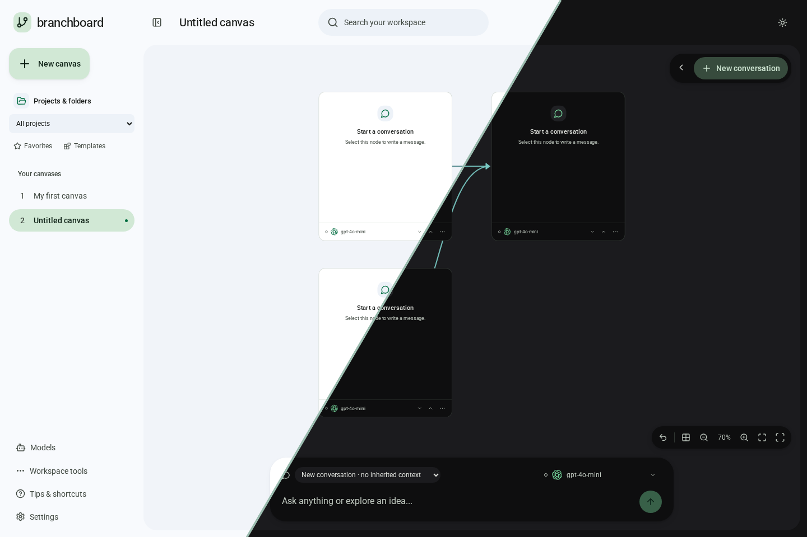

# BranchBoard

**A local-first canvas for AI conversations, shared context, notes, and research.**

BranchBoard lets you organize conversations visually, branch or merge their context, and
work with multiple AI providers from one workspace. Your boards are stored in your browser.

## Features

- Branch conversations or merge two selected parents into a shared child.
- Compare selected conversations with provider-reported or estimated token counts.
- Organize chats and notes on an infinite canvas with automatic family-colored connections.
- Dock, resize, float, snap, and maximize workspace panels.
- Use Markdown notes, annotations, projects, templates, search, and undo/redo.
- Import conversations and export boards as JSON, Markdown, PNG, or PDF.
- Choose per-conversation models and customize light and dark UI palettes.

## Screenshots

Desktop views from v1.10.1.

**Light & dark themes** — the same connected workspace, shown with a diagonal split.



## Quick start

**Requirements:** Node.js 22.12 or later and npm.

```sh
npm ci
npm run dev
```

Open [http://127.0.0.1:3000](http://127.0.0.1:3000). The development API runs on port 3001.

## Configure a provider

Open **Models → Manage providers** and configure OpenAI, Anthropic, Google Gemini,
OpenRouter, Groq, Ollama, Ollama Cloud, or a custom OpenAI-compatible endpoint. Local
Ollama requires an installed model and does not require an API key.

Credentials remain on the local server in the git-ignored, unencrypted
`branchboard.providers.json` file or in [`.env`](.env.example). They are not included in
workspace backups. Generating responses and explicitly testing a model may incur provider
charges; model tests do not send board content.

## Working with conversations

- Select two or more conversations with **Ctrl/⌘-drag** to open the token comparison island.
  It compares the latest reply for each conversation. Historical replies use estimates;
  provider-reported usage is shown when available. Add your own per-model USD rates to see
  cost estimates. These are not billing records.
- Select exactly two non-group cards and choose **Merge selected parents** to create a blank
  shared child. It inherits both histories as context; creation and both connections undo
  together.
- Connections are automatic. Branch a conversation or drop a card near another card's
  right edge; paths begin at each card's hidden center origin.
- The first Models or Settings panel docks. Drag its divider or focus it and use the arrow
  keys to resize. Additional panels float; use the snap menu or drag a panel to a screen
  edge to arrange it beside the canvas.

Right-click a canvas in the sidebar to favorite, move, or delete it. Keyboard users can press
**Shift+F10**; touch users can long-press. Deletion requires confirmation.

## Production

```sh
npm run build
npm start
```

Open [http://127.0.0.1:3001](http://127.0.0.1:3001). Browser storage is tied to the exact
origin, so export a workspace backup before changing ports or hostnames.

## Data and security

Boards and preferences are stored in this browser, not synced to an account. Clearing site
data can remove local work; export JSON backups for recovery. During generation, BranchBoard
sends the selected conversation and its upstream context to the configured provider.

BranchBoard is a single-user local application without authentication. Do not expose it
publicly.

## Development

```sh
npm test                         # Unit and HTTP tests
npx playwright install chromium
npm run test:e2e                 # Browser interaction tests
npm run screenshot              # Capture UI states (development server must be running)
```

## Documentation

[Changelog](CHANGELOG.md) · [Releases and previews](releases/README.md) ·
[Contributor guide](AGENTS.md) · [Visual QA](docs/visual-qa.md)

## Made by

- [Cresol3127](https://github.com/Cresol3127) (me)
- [clwr2007](https://github.com/clwr2007)
- [ullash-naik](https://github.com/ullash-naik)
- [Atharva1232](https://github.com/Atharva1232)

Thanks for building this together.

## LICENSE

This project has been licensed under MIT. For more details, see [`LICENSE`](LICENSE.md).
